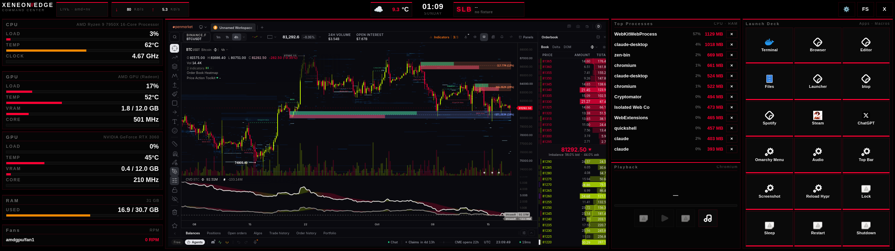
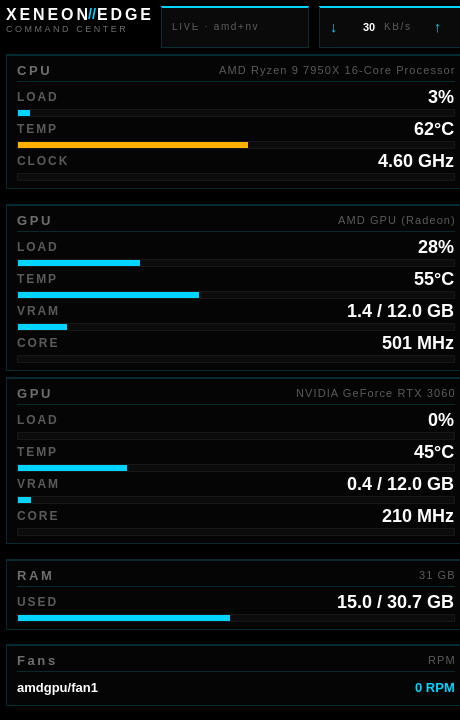
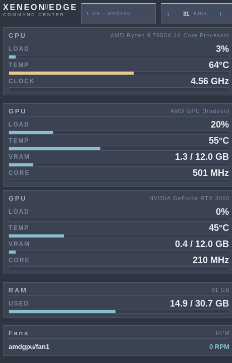
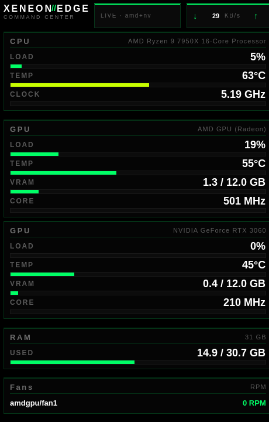
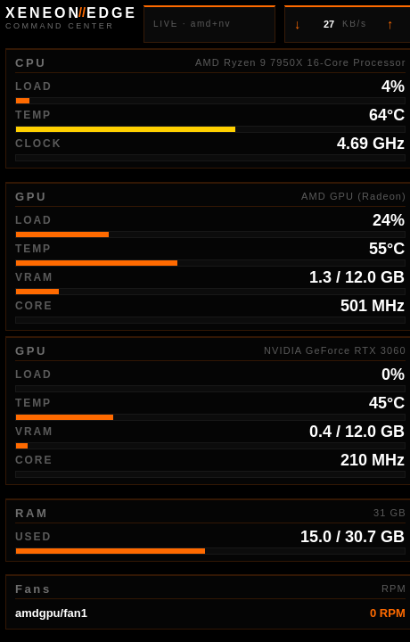
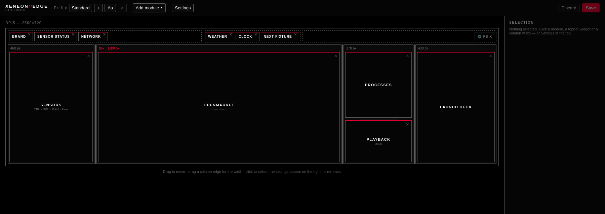

# Xeneon Edge Dashboard

*Deutsche Fassung: [README.de.md](README.de.md)*

A native GTK4 dashboard for Linux: sensors read straight from `/proc` and
`/sys`, no daemon, no Electron. Built for a 2560×720 strip such as the Corsair
Xeneon Edge, driven by touch, configured from a monitor that has a keyboard.
It started as the Linux port of a private Windows/WPF dashboard; only the
Linux version is published.



Sensors (CPU, AMD and NVIDIA GPU, RAM, fans), an OpenMarket chart from the
account, top processes, playback and the 3×6 launch deck. The sensor column
in the other four themes — Ice, Nord, Matrix, Ember:

<p>
   
</p>

The editor runs on the main monitor and writes `layout.json`; the dashboard
picks the change up without a restart:



## Features

- CPU: load, temperature, clock
- GPU: AMD (`/sys/class/drm`) **and** NVIDIA (NVML or `nvidia-smi`) side by side
- RAM, network throughput, fans (every hwmon fan)
- Top processes (psutil) — hold `×` to send SIGTERM
- Audio: PipeWire volume, mute and default-device switching (`pactl` / `wpctl`)
- Weather (Open-Meteo, location set in the editor) and the next fixture of a
  configured team (ESPN)
- TradingView module (WebKitGTK) — the anonymous widget with symbol, interval
  and indicators, or the real chart page with your own account and saved layout
- OpenMarket module — your own chart from an OpenMarket account, picked in
  the same sign-in window
- Playback: whatever is playing (MPRIS), or a music folder the dashboard plays
  itself
- 3×6 launch deck (18 pads), free split between apps and macros,
  hold-to-confirm for `poweroff`, `reboot` and friends
- Clock, calendar, notes modules; five colour themes plus one that follows
  the active Omarchy palette
- Everything laid out from `layout.json` through a graphical editor
- Autostart through `~/.config/autostart`

## Requirements

### Arch / Omarchy

One script — packages, verification, settings, deck template, autostart,
Hyprland window rules:

```bash
./scripts/install-arch.sh
```

Options: `--monitor DP-2` (pin a connector instead of auto-detecting),
`--no-autostart`, `--no-fullscreen`, `--yes` (no questions),
`--no-packages` (only rewrite settings and autostart), `--check` (verify
only), `--deck omarchy` (pre-fill the deck with Omarchy commands), `--no-hypr`
(do not write the window-rule snippet). Run it as your normal user, not with
`sudo`; it calls `sudo pacman` itself.

By hand, the same thing is:

```bash
sudo pacman -S --needed python-gobject python-cairo gtk4 libadwaita \
                        webkitgtk-6.0 python-psutil python-requests \
                        lm_sensors libpulse wireplumber pciutils \
                        adwaita-icon-theme xdg-desktop-portal-gtk \
                        gst-plugins-good
```

Everything is in `[core]`/`[extra]`; no AUR helper needed. `nvidia-smi` ships
with `nvidia-utils` and is tied to the driver package
(`nvidia`/`nvidia-open`/`-dkms`), so the script does not install it — it only
reports an NVIDIA card without `nvidia-smi` (Omarchy: `omarchy-install-nvidia`).
`python-nvidia-ml-py` is optional and replaces one `nvidia-smi` process per
tick (~28 ms) with an in-process NVML call (0.1 ms).

Arch specifics:

- **`gst-plugins-good`.** WebKitGTK builds a GStreamer pipeline for every
  `<audio>` element and every AudioContext and asks for `autoaudiosink` by
  name. For `webkitgtk-6.0` that package is only an *optional* dependency, so
  it is missing on a fresh install. WebKit then gets `NULL`, attaches a signal
  handler to it anyway and aborts — `WebKitWebProcess` dies with SIGABRT the
  moment TradingView touches audio. A present `pipewiresink` does not help;
  the name is looked up literally.
- **No `pip install --user`.** Arch marks its Python as *externally managed*
  (PEP 668). `psutil` and `requests` come from pacman; `requirements.txt` and
  `pyproject.toml` stay for venv setups.
- **No `pacman -Sy <package>`.** A partial upgrade is the usual road to broken
  dependencies on Arch; the script installs with `-S --needed` against the
  existing database and points to `sudo pacman -Syu` on failure.
- **`GDK_SCALE`.** Omarchy sets `env = GDK_SCALE,2` session-wide in
  `~/.config/hypr/monitors.conf` (or `hl.env("GDK_SCALE", ...)` in the Lua
  variant). The dashboard's column widths are hard pixels for 2560×720 — at
  buffer scale 2 only a quarter of the layout is visible. `run.sh` therefore
  exports `GDK_SCALE=1` for its own process; override with
  `XENEON_GDK_SCALE=2 ./run.sh`.
- **Monitor scale.** The strip itself wants 1×. In
  `~/.config/hypr/monitors.conf`: `monitor = DP-2, 2560x720@60, auto, 1` (the
  other monitors keep their scale).
- **Waybar** sits on *every* monitor by default and eats ~30 px of the 720 px
  strip. Restrict `"output"` in `~/.config/waybar/config.jsonc` to the other
  connectors — or `SUPER+SHIFT+SPACE`.

### Debian 13 (trixie)

```bash
./scripts/install-debian.sh
```

Same options as the Arch script minus `--deck` and `--no-hypr`. By hand:

```bash
sudo apt install python3-gi python3-gi-cairo gir1.2-gtk-4.0 gir1.2-adw-1 \
                 gir1.2-webkit-6.0 python3-psutil python3-requests \
                 lm-sensors pulseaudio-utils wireplumber \
                 gstreamer1.0-plugins-good gir1.2-gstreamer-1.0
sudo apt install nvidia-smi python3-pynvml   # NVIDIA only; both in 'non-free'
```

Debian specifics:

- **No `pip install --user`** — same PEP 668 situation as Arch; `psutil` and
  `requests` come from apt.
- **`gir1.2-webkit-6.0`** is the GTK4 WebKit (trixie: 2.52). Without it the
  chart column shows a placeholder; everything else keeps running.
- **`gir1.2-gstreamer-1.0`** are the GStreamer bindings the music-folder
  player uses. Without them the playback module cannot play a folder and
  says so.
- **`nvidia-smi`** lives in `non-free`. If apt cannot find it, add
  `contrib non-free non-free-firmware` to `Components:` in
  `/etc/apt/sources.list.d/debian.sources`.
- **No 2560×720 monitor?** Auto-detection finds nothing and the app opens as
  a normal window on the default display. Set the target with
  `--monitor <connector>` or later in the editor (Settings → target monitor).

### Fedora / Nobara

No installer script yet; the packages are:

```bash
sudo dnf install gtk4 libadwaita python3-gobject python3-psutil python3-requests \
                 lm_sensors pipewire-utils webkitgtk6.0 gstreamer1-plugins-good
sudo dnf install nvidia-smi python3-nvidia-ml-py    # NVIDIA only
```

## Running

```bash
./run.sh            # sets GDK_SCALE=1 and unbuffered stdout
python3 -m xeneon_edge
```

`run.sh` exports `WEBKIT_DISABLE_DMABUF_RENDERER=1`: on some multi-GPU
systems (AMD output next to an NVIDIA card) WebKitGTK does not hand its DMABUF
buffer through — the web process runs, the page loads, the chart column stays
black. Measured again on 2026-10-17 (Omarchy, WebKitGTK 2.52.6): black with
the DMABUF renderer, with and without the Mesa pinning below; visible with the
fallback renderer. So the fallback is the default. It was briefly the other
way round in September because the fallback hands over a half-finished frame
every few minutes (a black flash of one or two frames on the strip); whether
that still happens with WebKit on Mesa instead of the NVIDIA EGL is open.
`XENEON_WEBKIT_DMABUF=1 ./run.sh` switches the DMABUF renderer back on.

**Two GPUs, one of them NVIDIA.** On a machine with an AMD (or Intel) card
for the display and an NVIDIA card next to it — say, for LLMs — every EGL
client loads the NVIDIA driver first: GLVND lists `10_nvidia.json` before
`50_mesa.json`, and WebKit picks the first render node, usually
`renderD128` = NVIDIA. The chart's web process then renders through a driver
that has nothing to do with the display, and `libnvidia-eglcore` crashed four
times at the same address here (driver 610.57, October 2026). WebKitGTK 2.52
has no variable to choose the render node, so `xeneon_edge/webkit_env.py`
restricts GLVND to the Mesa vendor file (`__EGL_VENDOR_LIBRARY_FILENAMES`)
whenever an NVIDIA node and a Mesa node coexist. Dashboard, editor and login
window all do this before GTK opens the display; the journal says so
(`EGL nur ueber Mesa`). `XENEON_EGL_VENDOR=off` disables it, `=mesa` forces
it; a preset `__EGL_VENDOR_LIBRARY_FILENAMES` is left alone. Machines with
only one kind of GPU are not touched.

### Autostart

Either through the editor (gear → Settings → *Start with the session*) or:

```bash
./scripts/install-autostart.sh
```

Both write an XDG entry to `~/.config/autostart/xeneon-edge.desktop`. Under
Hyprland that is the whole story when the session is started through
**uwsm** (Omarchy does): systemd turns the `.desktop` file into
`app-xeneon\x2dedge@autostart.service` and starts it with
`graphical-session.target`. Do not add an `exec-once` on top — the dashboard
would start twice. Without uwsm (Hyprland straight from a TTY) XDG autostart
is not honoured; use `~/.config/hypr/autostart.conf` instead:

```
exec-once = uwsm-app -- "/path/to/xeneon-edge-dashboard/run.sh"
```

The journal of the running dashboard:

```bash
journalctl --user -u 'app-xeneon\x2dedge@autostart.service' -f
```

## Hyprland

### Window rules

`install-arch.sh` writes `~/.config/hypr/xeneon-edge.conf` (or `.lua` when the
Omarchy configuration has moved to Lua) and includes it from
`~/.config/hypr/autostart.conf` / `.lua`. It only undoes what the Omarchy
defaults would do to a status strip: the global 0.985 opacity, borders,
rounding, dimming in the background, and it sets `no_focus` so a SUPER+arrow
never makes the dashboard the active window. Touch and pointer events go to
the surface under the finger regardless of focus, so the deck keeps working.

The Lua variant also carries a guard that keeps the strip out of the window
dispatchers. `no_focus` is not enough for that: Omarchy's SUPER+SHIFT+arrow is
`swapwindow`, which swaps the active window with the next one in that
direction — and the dashboard is a window like any other to it, focus or not.
A swap towards the strip tiled the dashboard into the work workspace and left
the swapped window behind the strip. Hyprland has no switch to exempt a
monitor from window dispatchers, so the snippet subscribes to
`window.move_to_workspace` / `window.open` (`hl.on`, Hyprland 0.56+) and
tidies up one tick later: the dashboard goes back to the strip with its
fullscreen state restored, anything else that landed there returns to the
workspace it came from. The strip is `target_monitor` from `settings.json`,
or failing that the 2560×720 output. The classic `.conf` variant cannot do
this — it has no event API.

The rules match the application id: `io.github.johnytuga1904.XeneonEdge`
(dashboard), `.Login` (TradingView login) and `.Editor` (layout editor). The
dashboard places itself on the target monitor (`target_monitor` +
`fullscreen_on_target` in `settings.json`); a commented `monitor` rule sits
next to the others in case that ever fails.

### Where launched windows go

Setting *Monitor for launched windows* (`launch_monitor`) in the editor. It
applies to everything the dashboard opens: deck entries, the editor itself and
the TradingView login.

Without it the compositor decides, which in practice means the last focused
monitor. When the dashboard is used by touch that is sometimes the strip
itself — where the dashboard sits fullscreen in front and no keyboard is
attached, so the window is open but unreachable.

Technically the target monitor is focused right before the launch (new windows
open on the focused output). There are two `hyprctl` spellings and the
dashboard tries both:

| Configuration | Call |
|---|---|
| classic | `hyprctl dispatch focusmonitor DP-4` |
| Lua (Omarchy) | `hyprctl dispatch 'hl.dsp.focus({ monitor = "DP-4" })'` |

The classic call fails under Omarchy because a Lua parser reads the arguments
and takes `DP-4` for the expression "DP minus 4". Whichever form works first
is remembered. Without Hyprland the default behaviour stays; the setting is
best effort and never blocks a launch.

### Map the touchscreen to the strip

**The most common reason for "no button in the dashboard reacts".**

A touchscreen without an output mapping is projected by Hyprland onto the
*combined* area of all monitors, not onto its own. With three monitors
(5120×2160 in total) a tap on the strip lands, scaled, somewhere on the main
monitor: workspaces switch, text gets copied, other windows receive clicks —
and the dashboard gets *no* event at all. It looks like a broken dashboard and
is an input that never arrives.

Check:

```bash
hyprctl getoption input:touchdevice:output   # "[[Auto]]" = not mapped
hyprctl devices | sed -n '/Touch Device/,/^$/p'
hyprctl monitors -j | jq -r '.[] | "\(.name) \(.width)x\(.height)"'
```

Map it — Lua configuration (Omarchy), in `~/.config/hypr/input.lua`:

```lua
hl.device({ name = "wch.cn-touchscreen-1", output = "DP-5" })
hl.device({ name = "wch.cn-touchscreen",   output = "DP-5" })
```

Classic configuration:

```
device {
    name = wch.cn-touchscreen-1
    output = DP-5
}
```

Device names come from `hyprctl devices`, the connector from
`hyprctl monitors` — both differ from machine to machine. Two rules because the
same panel often reports two devices: the touchscreen and an absolute pointer.
To test without a reload:

```bash
hyprctl dispatch 'hl.device({ name = "wch.cn-touchscreen-1", output = "DP-5" })'
```

Whether a touch arrives can be checked without guessing — with
`XENEON_DEBUG_INPUT=1` the dashboard logs every press with its coordinate and
the widget it hit:

```bash
XENEON_DEBUG_INPUT=1 ./run.sh
# [input] touch-begin bei (2215,142) Fenster 2560x720 -> Label 'Terminal' button=DeckButton
```

If nothing shows up there, the touch never reaches the dashboard and the cause
is in the compositor.

### Deck template

The packaged `config/apps.json` is KDE-flavoured (`konsole`, `dolphin`,
`plasma-systemmonitor`). `config/apps.omarchy.json` sits next to it —
`xdg-terminal-exec`, `omarchy-launch-browser`, `nautilus`, `omarchy-menu`,
`omarchy-launch-audio`, `hyprctl reload`, `omarchy-toggle-waybar`. The
installer copies it only when `~/.config/xeneon-edge/apps.json` does not exist
yet.

### Notifications (Omarchy)

Omarchy puts its toasts on *every* output (`Variants { model:
Quickshell.screens }`), so also on the strip — right above the deck pads, where
dismissing them is awkward. A separate script, because it rewires the
notifications of the whole session and should not happen as a silent side
effect of installing a dashboard:

```bash
./scripts/install-omarchy-notifications.py --only DP-4
```

It does two things:

- **Keep toasts off the dashboard monitor.** Which one that is comes from
  `target_monitor` in `settings.json` (`--monitor` overrides). Without
  `--only` they go to all remaining outputs; with `--only DP-4` to that one
  output, with a fallback: if DP-4 is not connected they go everywhere except
  the strip rather than nowhere.
- **A close `×` in the top-right corner of the card.** The signal behind it
  (`closeRequested` → `dismissPopup`) is already wired in Omarchy; there was
  just no visible button, closing worked by right-click. The button is
  declared after `mainColumn` so it sits above the card-wide `MouseArea`;
  otherwise the click falls through to `onCardClicked` and triggers the
  notification's default action instead of closing it.

The script works on a clone of the plugin in
`~/.config/omarchy/plugins/<user>.notifications/` (`omarchy plugin clone`);
the original under `/usr/share/omarchy` is untouched. `--check` shows what
would happen, `--revert` takes everything back.

The clone freezes the Omarchy state it was cloned from — fixes to the
notification plugin no longer arrive. After a larger Omarchy update run
`--revert` and the script again. If an anchor no longer matches, it aborts at
exactly that spot instead of leaving something half-patched.

Do **not** clone `omarchy.bar`: even the unmodified clone makes the bar vanish
on all monitors. `omarchy plugin clone` works for `service` and `bar-widget`
plugins, not for the `bar` plugin. It is not needed either: Hyprland skips
`top` layers on a workspace with a fullscreen window, so the bar is invisible
on the strip. Only after `omarchy restart shell` does it sit over the header
until the dashboard restarts once.

## Configuration

Everything goes through the **editor** (`./scripts/layout-editor.py`, or the
gear on the strip). It opens on the main monitor because the strip has no
keyboard, and shows the strip as a stage in true proportion: the topbar with
its three slots on top, the columns below. Clicking a module, a topbar widget
or a column width shows the matching settings on the right — the form is
rendered from the module's `schema`. It shows only what has an effect in the
current mode: the clock's time-zone list appears only in the *Time zones*
display, *Shuffle* only with a music folder set, and the TradingView widget
options disappear entirely once your own chart is loaded. Longer blocks sit
behind a collapsed expander (`group` in the schema).

The launch deck appears as a 3×6 grid: click a pad, fields below, drag pads to
swap them. *Settings* in the header bar holds theme, target monitor,
autostart, hold-to-confirm, isolated launches and the memory cap. *Save*
writes `layout.json`, `settings.json` and `apps.json`; the running dashboard
watches all three and applies the change immediately. Modules whose type and
config are unchanged are reused — the chart does not reload because a column
got wider. Dragging a column edge snaps the width to **10 px steps** (the
strip is drawn about four times smaller in the editor, so one screen pixel is
several real ones and round numbers would be luck); the number field in the
inspector still takes any value. With several modules in one column the edge
between them can be dragged (`height` in percent per module); the process list
then shows as many rows as fit. Every deck pad has its own colour (`accent` in
`apps.json`, a colour dot on the pad in the editor): the bottom border line of
the pad on the strip.

### Modules

| Module | Shows | Settings |
|---|---|---|
| Sensors | CPU, GPU, RAM, fans | which of them (`metrics`) |
| Processes | top processes by CPU | number of rows |
| Audio | output/input, volume | — |
| Launch deck | 3×6 grid of apps and macros | in the editor under *Launch deck* |
| Web panel | a WebKit view on an address | address, zoom |
| TradingView | chart widget or your own chart | source, symbol, interval, time zone, indicators, toolbars |
| OpenMarket | your own chart from an OpenMarket account | chart address (set by *Sign in / choose chart*), zoom (default 72 %) |
| Clock | time, large | display, seconds, time zones |
| Calendar | the current month | week start, week numbers |
| Playback | what is playing, with buttons | player, cover on/off, music folder, shuffle |
| Notes | one file, read-only | file |

**Clock.** Three displays: *Time and date*, *Time only*, *Time zones*. The
digits scale to the area the module gets in the layout — a narrow column shows
them small, the whole strip makes a wall clock. In *Time zones* each line is
one zone; the field takes `Name=Zone`, comma-separated:

```
London=Europe/London, New York=America/New_York, Tokyo=Asia/Tokyo
```

Zone names are those in `/usr/share/zoneinfo`. Without `=` the entry is the
zone and the last path element becomes the label (`America/New_York` →
`NEW YORK`). An unknown zone is skipped and logged; the other lines stay.

**Calendar.** The current month as a grid, today highlighted, days of the
neighbouring months dimmed. Deliberately **without appointments and without a
network connection** — it exists to look up which weekday the 23rd is. Week
start (Monday or Sunday) and ISO week numbers are configurable. Weekday and
month names follow the system locale, like the date in the clock module.

**Playback.** Title, artist, cover and progress of the player that is
currently running, with previous / play-pause / next. This goes through
**MPRIS**, the D-Bus interface practically every Linux player speaks — Spotify,
YouTube in a browser, mpv, VLC. Nothing to set up: if a player runs, it is
there.

The *Player* field is normally empty, then whichever is playing is taken.
With a value (`spotify`, `mpv`, `firefox`) *only* that one counts — if it is
not running the module says so instead of showing a different one.

The module adapts to its size: title, artist and buttons are always present,
cover and progress bar appear when there is room. A live stream has no bar
(it reports no duration). Buttons the player does not support are greyed out.

With a mouse the Omarchy bar is more convenient: `omarchy bar put
omarchy.media` puts the same thing as a bar widget on the main monitor.

**Music folder: the module plays itself.** With a path in *Music folder* no
external player is needed. The folder is scanned recursively for audio files
(`.mp3 .flac .ogg .opus .m4a .aac .wav .wma` and a few more, plus video
containers such as `.webm .mp4 .mkv`, whose audio track is played; at most
5000) and a fourth button with a folder icon starts it — a separate button,
because play belongs to whatever player is on screen, and with two browsers
on the bus there almost always is one. While the folder is playing that
button is lit; pressing it again stops the folder and the other player comes
back. Next and previous page through, the list stops at its end. *Shuffle*
mixes once at start.

Playback goes through a GStreamer pipeline that decodes audio only — not
`Gtk.MediaFile`, which would also decode the picture of a downloaded concert
video that nobody sees (measured: 70 % of a core for a 4K AV1 file versus
1 %). Without the bindings and plugins (`gst-plugins-base`, `gst-plugins-good`;
Debian: `gir1.2-gstreamer-1.0`) the module says so in plain text instead of
staying silent.

Which player the module shows is decided by what is actually audible when no
player reports "Playing": Brave (Chromium) has been seen reporting "Paused"
with a frozen position while YouTube kept playing. The module then asks the
sound server which process is emitting sound (a short level probe per open
stream, so a muted autoplay tab does not count) and shows that player as
playing; only its progress bar stays put, because the position is known to
the browser alone.

Title and artist come from the **file name** and the folder above it, not from
tags — with the usual `Artist/Album/01 Title.flac` layout that is right. The
cover is an image in the same folder (`cover`, `folder`, `front`, `album`,
`albumart` as `.jpg`, `.png` or `.webp`); embedded artwork is *not* read.

Both sources share the three buttons. The own player wins while it is playing;
paused, it steps back as soon as something else plays — start Spotify and
Spotify takes over the display without the own track being lost.

**Audio only, no video.** The module shows covers as still images, nothing
more. A YouTube video runs in the browser and stays there: MPRIS delivers
metadata, not pictures, and under Wayland another program's window cannot be
pulled onto the strip. For moving pictures on the strip use a **web panel**
with the YouTube address — at the price of a separate WebKit process.

**Video in a web panel.** A web panel takes any address, YouTube included. For
WebKit to decode the picture it needs more than `gst-plugins-good`:

```bash
sudo pacman -S --needed gst-plugins-bad gst-plugins-ugly gst-libav
```

Every web panel costs its own WebKit process and video is expensive. The
Spotify web player does *not* work — it needs Widevine DRM, which WebKitGTK
does not ship. For Spotify use the desktop client plus the playback module.

**Notes.** Shows a `.txt`, `.md` or `.json` file and reloads it when it
changes — it is written elsewhere, on the machine with the keyboard. JSON is
pretty-printed; broken JSON stays raw. Markdown is **not** rendered, it is
shown as plain text.

The module is used by finger: swipe to scroll, tap a line to copy it to the
clipboard — the line flashes briefly in the accent colour. Without a keyboard
on the strip that is the only way to get something out of the file. At most
1500 lines are shown; the last line reports the rest.

### Files

- `config/apps.json` — default apps and macros (in the repo, a template)
- `~/.config/xeneon-edge/apps.json` — user override (the editor writes here)
- `~/.config/xeneon-edge/settings.json` — `auto_start`, `hold_to_confirm`,
  `isolate_launches`, `deck_app_slots`, `target_monitor`, `launch_monitor`,
  `fullscreen_on_target`, `chart_url`, `openmarket_url`, `theme`,
  `web_memory_limit_mb`
- `~/.config/xeneon-edge/layout.json` — version 3: profiles with `topbar`
  (slots `left`/`center`/`right`, each a list of `{type, config}`) and
  `columns` (width + modules). Topbar widgets: `brand`, `status`, `net`,
  `clock`, `weather` (`lat`, `lon`, `label`), `match` (`league`, `team`,
  `short` — ESPN codes). Version 1 and 2 files are migrated on load:
  1 → topbar slots, 2 → TradingView as its own module. What no visible
  module needs, the aggregator does not read: no process module, no psutil
  pass; no weather widget, no Open-Meteo request.
- `~/.local/share/xeneon-edge/webkit/` — the WebKit profile of the chart
  (cookies, local storage), created 0700 on first use.

### Colour themes

`theme` in `settings.json`, or editor → Settings → *Colour theme*; the switch
applies immediately. Shipped in `xeneon_edge/themes/`:

| `theme` | Look |
|---|---|
| `crimson` | red on black (default) |
| `ember` | orange on black |
| `ice` | cyan on black |
| `matrix` | green on black |
| `nord` | grey-blue, no pure black |
| `omarchy` | follows the active Omarchy palette |

A custom theme is another `.toml` in that folder — copy `crimson.toml`, change
the 13 colours, done; the file name is the value for `theme`. `style.css`
contains no colour values, only names (`@accent`, `@bg`, …) that `theme.py`
defines from the palette in front of it. The anonymous TradingView widget
takes background and grid from the same palette; the full chart page with an
account brings its own theme.

`omarchy` reads `~/.local/state/omarchy/current/theme/colors.toml` and watches
the directory: `omarchy-theme-set` recolours the dashboard along. The entry
appears only when that file exists — on Fedora/KDE it is absent. The mapping
(Omarchy `accent` → accent, `red` → hot, `yellow` → warm, three background
levels → window/panel/buttons) is in `theme.py`.

### Deck split

The deck has a fixed 18 pads (3 columns × 6 rows, `DECK_*` in
`config_store.py` — the pad height is tuned to the 660 px content area of the
strip). `deck_app_slots` (editor → Launch deck → *Pads for apps*, 0–18) says
how many go to apps; the rest are macros:

| `deck_app_slots` | Deck |
|---|---|
| `0` | all 18 pads are macros |
| `9` (default) | rows 1–3 apps, rows 4–6 macros |
| `18` | all 18 pads are apps |

Pads are filled slot by slot, not row by row: with `4`, apps and macros share
the second row. The Apps/Macros tabs show exactly as many slots as the deck
renders for that category — what is there ends up on the display.

Entries beyond the current quota are kept in `apps.json`: moving the slider
down and up again brings them back unchanged.

A slot with a command but no label labels itself with the command's file name
(`display_label()` in `ui/deck.py`); such a slot used to look empty and still
fire on tap. Labels wrap to two lines (11 px, minimal letter spacing).

### Launching deck entries

Default (`isolate_launches: true`) is `systemd-run --user`: every entry gets
its own transient unit `xeneon-deck-<slot>-<id>.service` (e.g.
`xeneon-deck-02-macro2`) and with it its own cgroup under `app.slice`. The
slot number is part of the name because `id` is not unique — entries move when
reordered, their `id` stays.

This is not cosmetic. Started with `subprocess.Popen`, the process would stay
a child of the dashboard and live in *its* unit — for a local llama.cpp server
with `--threads 16` that means UI and model share CPU weight and memory
reclaim, and the dashboard stutters while the model loads and during
inference. On top, a `systemctl --user restart` of the dashboard would take
the model server with it (`KillMode=control-group`), and stop scripts that
derive the unit from `/proc/PID/cgroup` would hit the dashboard unit.

In practice:

```bash
systemctl --user list-units 'xeneon-deck-*'        # what is running?
systemctl --user stop     xeneon-deck-02-macro2    # stop cleanly
journalctl --user -u      xeneon-deck-02-macro2 -f # the script's output
```

A second tap on a running entry does not start a second instance; it fails
with "unit already exists", logged in the dashboard's journal.

Single entries opt out with `"launch": "direct"` in `apps.json`; the switch in
the editor (Settings) reverts globally to the plain Popen behaviour.

### Icons

The `icon` field of an entry accepts three forms, tried in this order:

1. **Bundled icon** from `xeneon_edge/icons/` by name — extension and
   `-symbolic` optional, `llm-start` finds `llm-start-symbolic.svg`
2. **Absolute path** to an SVG or PNG
3. **Icon-theme name** (`utilities-terminal`, `system-run-symbolic`, …)

Three matching chip symbols for local LLM servers are bundled:

| Name | Symbol | Meant for |
|---|---|---|
| `llm-start` | chip with ▶ | start the model server |
| `llm-vision` | chip with an eye | multimodal model |
| `llm-stop` | chip with ■ | stop the server |

Without an `icon` field the automatic lookup runs: macro-id keyword
(`shutdown`, `lock`, …) → matching `.desktop` file → theme name → category
fallback. Theme names are checked with `has_icon()` before being returned;
otherwise every shell script ended up at "command name as icon name" and all
script macros showed the same "no entry" symbol.

## TradingView

TradingView is a **module of its own**, separate from the web panel. The web
panel only asks for an address; TradingView asks *how* — field *Source*:

| Source (`mode`) | What runs |
|---|---|
| `widget` (default) | the *Advanced Chart* widget, anonymous, configurable |
| `account` | the real chart page with your saved layout, from `url` |

Up to layout version 2 both were a web panel: an empty address meant
"widget", a `tradingview.com` address meant "own chart". Existing layouts are
converted on load.

**Configuring the widget.** In the editor behind the *Widget settings*
expander — with source *Own chart* the block is absent, the account layout
applies there anyway. Symbol (`BINANCE:BTCUSDT`, `NASDAQ:AAPL`, `SIX:NESN` …),
interval, time zone (defaults to the system zone), toolbars on/off and the
indicators to tick:

| Display | Id |
|---|---|
| Volume | widget option (`hide_volume`), does not count towards the limit |
| RSI | `STD;RSI` |
| MACD | `STD;MACD` |
| Bollinger Bands | `STD;Bollinger_Bands` |
| EMA / SMA | `STD;EMA`, `STD;SMA` |
| VWAP | `STD;VWAP` |
| Stochastic RSI | `STD;Stochastic_RSI` |
| Ichimoku Cloud | `STD;Ichimoku%1Cloud` |
| Supertrend | `STD;Supertrend` |
| RSI Divergence | `STD;Divergence%1Indicator` |

Two things you only learn by measuring — the widget reports **no error**, it
simply drops the indicator:

- **At most five indicators.** Anything beyond is silently discarded, and it
  is the *last* ones in the list. The module therefore caps at five itself
  (`TV_MAX_STUDIES` in `ui/chart.py`).
- **The list is complete.** ATR, OBV, ADX, MFI and Awesome Oscillator were
  tried in several spellings and recognised by none; they are not offered
  rather than showing a checkbox that does nothing. If you need them, use
  your own chart — it brings the indicators from the account.

The embedded widget **cannot** load saved layouts — it has no account and
takes only the parameters above. To see your drawings and templates you load
the real page and are signed in there.

**Signing in** happens through the editor: click the TradingView module →
**Sign in / choose chart**. The button runs the same script you can start by
hand:

```bash
./scripts/tradingview-login.py
```

It opens the same browser session in a normal 1400×900 window on the main
monitor — the strip usually has no keyboard. It does not land there by
itself: Hyprland puts new windows on the focused workspace, and that is the
strip exactly when the login was started by touch from the dashboard. So the
window picks its monitor itself (`find_login_monitor` in `ui/monitors.py`,
the largest output other than `target_monitor`). GTK4 cannot position a window
on Wayland — `fullscreen_on_monitor()` is the only API that takes a monitor at
all. So it goes fullscreen there for one frame and leaves fullscreen again;
the compositor then already has the window on the right output. That it
floats instead of tiling is the rule from `install-arch.sh`.

Sign in there, open the saved chart you want, press *Use as chart*: that
writes the current URL to `chart_url` and closes the window. Login through
Google or Apple opens a popup — the script catches it and shows it in its own
window (without that handler nothing happens on click).

The profile lives in `~/.local/share/xeneon-edge/webkit/` (`cookies.sqlite`
plus local storage). It is persistent only because the `NetworkSession` is
built explicitly with that directory — a default `WebKit.WebView()` keeps its
cookie jar in memory and the login would be gone after every restart.

Things to know:

- **No restart needed.** The editor waits for the login window to close,
  enters the URL into *Chart address* and sets *Source* to *Own chart*; after
  *Save* the panel in the running dashboard switches over. Closing the window
  without *Use as chart* changes nothing. The *Back to the widget* button switches
  the source back and leaves the address in place. The address can also be
  typed by hand — the editor runs on the monitor with a keyboard.
- **The first build takes a while.** The panel stays empty for a few seconds
  until layout and indicators are loaded — the anonymous widget is up almost
  immediately. Not a bug, the price of your own layout.
- **Telemetry requests fail** (`telemetry.tradingview.com`, `TypeError: Load
  failed`) with an ad blocker or DNS filter active. No consequences — the
  chart loads completely.
- **The full page costs more** than the widget: its own web process, more
  RAM, more CPU. For a panel that runs all day it is noticeable — freshly
  loaded about **1 GB RSS and 5 % of one core**, and the page grows over hours
  (3.7 GB peak of the dashboard unit was measured). That is why the web
  process has a cap, `web_memory_limit_mb` in `settings.json` (default 1536,
  0 = off, measured as the web process's RSS): at 70 % WebKit releases caches,
  at the limit it terminates the web process and the panel reloads the page
  three seconds later — visible as a briefly empty panel, logged as "web
  process terminated (exceeded-memory-limit)". The same reload path covers a
  crashed web process; before, the panel stayed blank until a restart.
- **The session can expire.** The panel then shows the login wall instead of
  a chart; in the editor, click *Sign in / choose chart* again.
- **The login window has no memory cap.** The Google login opens a popup in
  the same web process; together the two reached 1.6 GB — with the chart
  panel's cap the process was killed after 30 s and the window stopped taking
  input. A second start brings the existing window to the front instead of
  opening a second one.
- Automated sign-in would be against the TradingView terms of service — hence
  a window to sign in yourself and no script that types credentials.

## OpenMarket

OpenMarket ([openmarket.xyz](https://openmarket.xyz)) is the second chart
source, a **module of its own** next to TradingView. There is no anonymous
widget: the module always shows your own chart from the account, from the
address in *Chart address* (`url`, of the form
`https://openmarket.xyz/chart/<id>`). Whoever wants no chart at all removes
the module in the editor — the centre column takes any other module, or
none.

Signing in works exactly as for TradingView: click the OpenMarket module in
the editor → **Sign in / choose chart**. The same script, with the site as
argument:

```bash
./scripts/tradingview-login.py --site openmarket
```

Sign in, open the chart, *Use as chart* — that writes the address to
`openmarket_url` in `settings.json`, the editor copies it into the module.
Both sites share one WebKit profile, so a TradingView session and an
OpenMarket session live side by side.

The page is laid out for a wide desktop browser; in the strip's centre
column (about 1270 px) it clipped the order book on the right. The module
therefore applies a page zoom of **72 %** by default (*Zoom* in the editor,
50 to 150), which gives the page about 1760 CSS pixels — 80 % still cut the
order book's total column; the web panel has the same field with a default
of 100.

Measured on the strip over six hours (2026-10-16, Fedora, AMD GPU): the
OpenMarket page sits at about 1 GB RSS and keeps **roughly a third of a core
busy** — around 30 % — the whole time, where the TradingView account chart
needs about 5 %. Memory stayed flat and the page never reloaded. The CPU
cost is the one thing to weigh before choosing it; the memory cap
(*Web panel memory cap* in the settings) applies to it like to every web
view.

## Controls

- Gear: opens the editor on the main monitor — layout, module settings, deck
  and all settings in one place
- `FS`: toggle fullscreen
- `X`: quit
- Macros with `confirm: true`: hold the pad about 1 s until it lights up red
- `×` in a process row: hold ~0.8 s (the button fills red) → SIGTERM. A short
  tap does nothing; while holding, the list freezes so a reorder cannot push
  the wrong process under your finger.

## Under the hood

| Area | Source |
|---|---|
| CPU load | `/proc/stat` |
| CPU clock | `/proc/cpuinfo` |
| CPU temp | `/sys/class/hwmon/*` (k10temp/coretemp) |
| RAM | `/proc/meminfo` |
| Network | `/proc/net/dev` |
| Fans | `/sys/class/hwmon/*/fan*_input` |
| AMD GPU | `/sys/class/drm/cardX/device/{gpu_busy_percent,mem_info_vram_*}` + hwmon |
| NVIDIA | NVML (`pynvml`), fallback `nvidia-smi --query-gpu=...` |
| Audio | `pactl get/set-sink-volume`, `set-default-sink`, `wpctl`; re-read only on an event from `pactl subscribe` |

No administrator rights are needed. The sensor
thread polls once a second and only what a visible module declares in
`needs`; snapshots reach the UI through `GLib.idle_add`.

## Known limitations

- The AMD GPU name is derived from `modalias` and generic ("AMD GPU
  (Radeon)"); a nicer name would need `lspci`.
- Without `pynvml` (Arch `python-nvidia-ml-py`, Debian `python3-pynvml`) the
  NVIDIA values come from `nvidia-smi`, one process start per tick (~28 ms).
  With NVML it is 0.1 ms; the status pill does not show which path is active,
  `verify-install.py` does.
- If `pactl subscribe` cannot run (no sound server yet), audio is polled every
  2 s and the watcher is retried every 30 s; with events it is read only on
  change plus every 30 s as a safety net.
- Autostart is an XDG entry: honoured by GNOME, KDE and any session started
  through uwsm, not by a bare Hyprland session.
- MPRIS property reads are synchronous D-Bus calls on the main loop with a
  500 ms timeout; a hung player can stall the UI briefly.

## Directory layout

```
xeneon-edge-dashboard/
  run.sh                       # GDK_SCALE=1, unbuffered stdout, WebKit renderer switch
  pyproject.toml               # metadata, ruff config
  requirements.txt             # for venv setups only; distros use their packages
  config/apps.json             # deck template (KDE-flavoured)
  config/apps.omarchy.json     # deck template for Omarchy
  scripts/install-arch.sh      # Arch/Omarchy setup: packages, verify, settings, deck, Hyprland rules
  scripts/install-debian.sh    # Debian 13 setup: packages, verify, settings, autostart
  scripts/install-autostart.sh # writes the XDG autostart entry
  scripts/verify-install.py    # dependency check used by both installers
  scripts/layout-editor.py     # the editor window (WebKit page + GTK bridge)
  scripts/tradingview-login.py # one-off login for the chart modules (TradingView, --site openmarket)
  scripts/install-omarchy-notifications.py
  xeneon_edge/
    app.py             # Adw.Application, CSS, file watchers, aggregator wiring
    config_store.py    # settings.json + apps.json + autostart .desktop
    layout_store.py    # layout.json: profiles, topbar, columns, migrations
    launcher.py        # deck launches via systemd-run, monitor focusing
    theme.py           # palettes (themes/*.toml, Omarchy) → @define-color
    themes/            # crimson, ember, ice, matrix, nord
    style.css          # GTK4 stylesheet, colour names only
    icons/             # bundled symbolic icons
    editor/            # editor page (assets/) and the message handler
    modules/           # module registry + the bundled modules
    sensors/           # cpu, gpu_amd, gpu_nvidia, ram, net, fans, audio, processes, mpris, weather, match, aggregator
    ui/                # window, panels, gauges, deck, chart, clock, calendar, notes, media player, layout helpers
```
